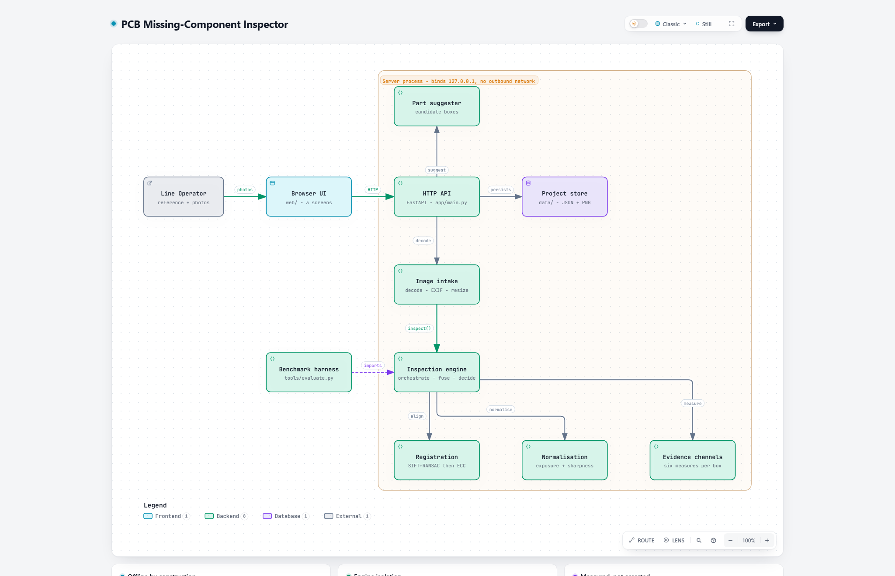

# Architecture



**[Open the interactive diagram →](docs/architecture.html)**, a standalone
file with light/dark themes, route highlighting and source links back to the
exact lines in this repository. Download and open it in a browser; it needs no
server and no network.

<details>
<summary>How this diagram was produced (Archify, as the brief specifies)</summary>

Made with [Archify](https://github.com/tt-a1i/archify) 3.2.0, following its
install instructions at
`https://raw.githubusercontent.com/tt-a1i/archify/main/llms.txt`:

```bash
npx -y skills@latest add https://archify.si --list --full-depth        # discover
npx -y skills@latest add https://archify.si --skill archify \
    --agent claude-code --copy --yes                                   # install (project only)
node .claude/skills/archify/bin/archify.mjs doctor                     # "Archify is ready."

node .claude/skills/archify/bin/archify.mjs finalize architecture \
    docs/architecture.candidate.json docs/architecture.html \
    --repo-root . --quality showcase --json
```

The diagram source is committed as
[`docs/architecture.candidate.json`](docs/architecture.candidate.json), pinned
to commit `0eca94a` with per-component source citations, so every box in it
links to the code that backs the claim.

All four of Archify's gates pass: schema **validate**, **deliver**, strict
provenance **check**, and a real-browser **browser-check**.

The first run failed on purpose-built grounds and is worth recording: a
1360 px canvas pushed the 8 px edge labels below the desktop readability floor.
The fix was to compact the column pitch to 1150 px rather than to shrink the
content, the same "fix the cause, not the threshold" move as Decision 5 in
[`AI_COLLAB.md`](AI_COLLAB.md).

The 203-file Archify package itself is installed locally and git-ignored; it is
a tool, not part of this project's source.

</details>

See §7 for exactly what the diagram asserts, so it can be checked against the
code.

---

## 1. Shape of the system

Four layers, each one testable without the one above it:

| Layer | Lives in | Knows about |
|---|---|---|
| Interface | `web/` | HTTP, nothing else |
| HTTP API | `app/main.py` | request validation, serialisation |
| Support | `app/imaging.py`, `app/storage.py`, `app/config.py` | bytes, files, constants |
| Engine | `app/vision/` | NumPy arrays only |

The important boundary is the last one. `app/vision/` has no imports from
FastAPI, no knowledge of where images came from or where results go. That is
what lets `tools/evaluate.py` run 1,920 inspections head-less without starting
a server, and that harness is what caught both of the metric bugs described in
[`AI_COLLAB.md`](AI_COLLAB.md).

## 2. One inspection, end to end

```
photo bytes
   ↓  imaging.decode_upload      EXIF orientation, BGR, size check
   ↓  imaging.to_working_size    long edge ≤ 1800 px
   ↓  imaging.fit_to_reference   same raster as the reference
   ↓  registration.align         SIFT+RANSAC → validate → ECC → identity
   ↓  registration.warp          test frame now in reference coordinates
   ↓  photometric.match_levels   robust per-channel gain + offset
   ↓  photometric.match_sharpness blur the sharper of the two
   ↓  for each named box:
   │     metrics.best_offset_ncc    local re-alignment, ±margin
   │     six evidence channels → six 0..1 "missingness" scores
   ↓  inspector._fuse            weighted sum, then presence vetoes
   ↓  scene compensation         capped, population-level
   ↓  thresholds                 present / review / missing
   ↓  storage.store_run          JSON + test + aligned + per-part crops
JSON verdicts
```

## 3. Why a local web app

| Option | Why not |
|---|---|
| Command-line tool | The brief scores UI/UX, and the user is a shop-floor operator |
| PyQt / Tkinter desktop app | Drawing boxes on a zoomable canvas, drag-and-drop, and a printable report are all work in a toolkit and free in a browser; packaging is worse on three platforms |
| Electron | Hundreds of megabytes and a Node toolchain to render HTML the user already has a renderer for |
| **Local FastAPI + browser** | **Chosen.** `pip install`, `python run.py`. Full CSS control, no build step, and the browser's file picker, drag-and-drop, canvas and print pipeline come free |

The cost is that it *looks* like a web app, which could invite doubt about the
offline requirement. That is answered concretely: it binds to `127.0.0.1`, and
the page loads no CDN script, no web font and no external stylesheet, every
byte is served from `web/`.

## 4. Why files instead of a database

Projects are directories: `data/projects/<id>/` with `project.json`,
`reference.png` and `runs/<id>/`. One operator on one line never has concurrent
writers, so a database buys nothing and costs transparency. When a verdict is
disputed, being able to open the stored crops in a file manager is worth more
than SQL. JSON writes are atomic (temp file + `os.replace`) so a crash cannot
truncate a project.

**Given up:** no query across boards, no multi-user access, no retention policy.
All of those become real at plant scale, and all of them are a migration, not a
redesign: `storage.py` is the only module that touches the disk.

## 5. Why six signals and a fixed fusion

Any single metric has a failure mode a factory will find within a shift. SSIM
is fooled by a change of focus; colour by a white sticker; edges by exposed
pads as busy as the part that covered them. The engine measures six
deliberately redundant things and fuses them with weights set by measured
discriminating power on the benchmark.

**Given up:** a learned combiner (logistic regression, gradient boosting) would
almost certainly fit better. It needs labelled data from the deployment, which
does not exist at setup time, the whole premise is a board nobody has seen.
Fixed weights are auditable, live in one file, and behave predictably on
hardware the author never saw.

**Given up:** the vetoes and the capped scene compensation are heuristics, not
probability. They encode a real asymmetry, a tool that cries wolf gets ignored,
and an ignored tool catches nothing, but they are the first thing I would
revisit with field data.

## 6. Other trade-offs worth naming

| Chose | Gave up |
|---|---|
| Working resolution capped at 1800 px long edge | Detail on very large images. Keeps a board under a second and keeps SIFT honest; components below ~10 px were never going to be decidable anyway |
| Replacing the reference discards its parts and runs | Convenience. Keeping boxes against a new photo silently misaligns every ROI, which produces confident nonsense, the worst possible failure |
| Rendered benchmark instead of photographs | External validity. Bought exact ground truth, a controllable nuisance model, and a benchmark that ships in the repo. Stated plainly in `README.md` and `RESEARCH.md §4` |
| Autosave of named parts | An explicit save step some users expect. Losing forty boxes to a closed tab is not recoverable; a surprising save is |
| Whole batch returned in one response | True streaming progress. Three to twelve boards at ~0.7 s each does not justify websockets; the progress bar is paced to the measured rate and never claims completion early |
| Vanilla ES modules, no bundler | Type checking, tree shaking, component libraries. The reviewer runs two commands and it works; there is no `npm install` that can fail on their laptop |
| Sensitivity as an operator control | A single "correct" threshold. Optics differ between lines, and the honest answer to "what threshold?" is "it depends on your camera" |

## 7. What the diagram asserts

So it can be checked against the code rather than taken on trust:

- `web/` talks **only** to `app/main.py` over HTTP on `127.0.0.1`; it has no
  other network target.
- `app/main.py` is the **only** module that imports FastAPI.
- `app/vision/*` imports **only** `cv2`, `numpy` and `app.config`, never
  `app.storage`, `app.main` or `fastapi`.
- The four engine stages run in the order shown, once per test photograph.
- Everything written to disk lands under `data/`.

```bash
# verify the dependency claims
grep -rn "fastapi\|storage" app/vision/     # expect no matches
grep -rln "fastapi" app/                    # expect only app/main.py
```
