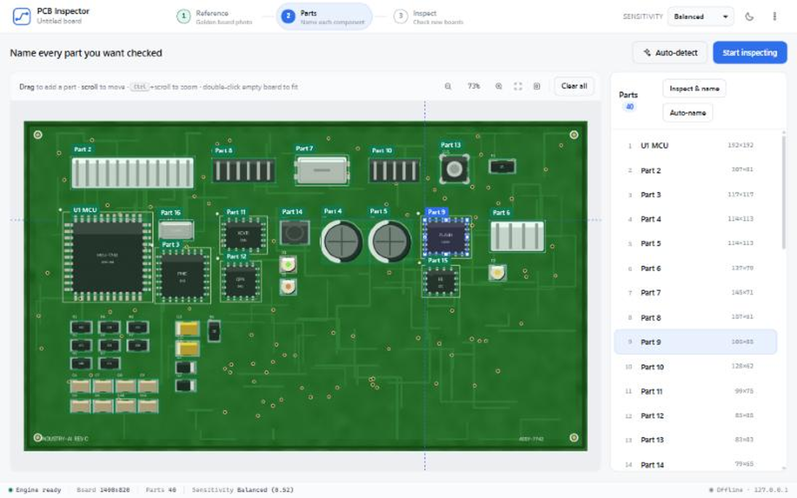
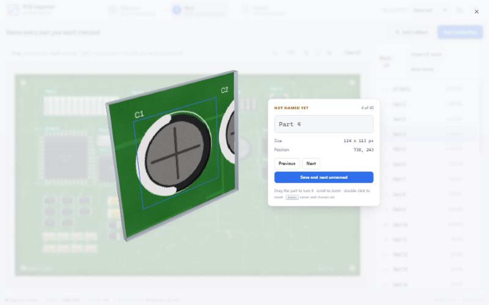

# PCB Missing-Component Inspector

**Take-home Task B: "Which Part Is Missing?"**

Upload a photo of a good board, name the parts on it once, then drop in photos
of boards from the line. For each one the app says which named parts are
missing and shows where, or **OK** in green.

Classical computer vision, no training data, **no network access at runtime**.





---

## Quick start

Requires **Python 3.10+**. Nothing else: no Node, no build step, no model
download.

```bash
pip install -r requirements.txt
python run.py
```

That starts a local server on `127.0.0.1:8000` and opens your browser. If port
8000 is busy it picks the next free one and prints the address.

```bash
python run.py --port 9000     # choose the port
python run.py --no-browser    # don't open a browser
```

Press `Ctrl+C` to stop.

<details>
<summary>Using a virtual environment (recommended)</summary>

```bash
python -m venv .venv
# Windows:
.venv\Scripts\activate
# macOS / Linux:
source .venv/bin/activate

pip install -r requirements.txt
python run.py
```
</details>

---

## Try it in 60 seconds

Sample boards ship with the repo, so you can see it work before pointing a
camera at anything.

1. Run `python run.py`.
2. **Step 1**: drop in `samples/boards/golden.png`.
3. **Step 2**: click **Auto-detect**. It proposes a box per component; rename
   any you care about, or just continue. (You can also drag boxes by hand,
   that is the normal way.)
4. **Step 3**: drop in several files from `samples/boards/`, for example
   `board_01_ok_clean.jpg`, `board_11_missing_metal.jpg` and
   `board_12_missing_lookalike.jpg`.

The first comes back **OK**; the others name exactly the parts that were
removed. `samples/ground_truth.json` lists the right answer for every file.

Click any board for the detail view: the reference crop next to this board's
crop, the six measurements behind the verdict, and a compare slider.

---

## How it works

For each test photograph:

1. **Register** it onto the reference: SIFT + RANSAC homography, validated
   against a plausibility envelope, with ECC intensity alignment as a fallback.
   A fixed camera still drifts a few pixels, and a few pixels is enough to make
   every comparison fail.
2. **Normalise the nuisances**: robust per-channel exposure matching, then
   sharpness equalisation (blur whichever image is sharper until they match).
   A comparison may only use information that *both* images contain.
3. **Measure each named box** on six independent signals: template correlation,
   SSIM, gradient-outline correlation, CIELAB chroma distance, texture-energy
   ratio and normalised residual.
4. **Fuse** them into one confidence, apply presence vetoes that suppress false
   alarms, and apply a capped correction if the whole photograph is degraded.
5. **Decide**: Present / Needs review / Missing.

Six redundant signals rather than one clever metric, because every single
metric has a failure mode a factory finds within a shift: SSIM is fooled by a
change of focus, colour by a white sticker, edges by exposed pads as busy as
the part that covered them. Agreement across independent measurements is what
survives a board nobody has seen before.

[`ARCHITECTURE.md`](ARCHITECTURE.md) has the diagram and the trade-offs.
[`RESEARCH.md`](RESEARCH.md) has what was compared and rejected.

---

## Measured results

Against the generated benchmark: 80 board photographs spanning the full
nuisance range, **41 named parts** each, **3,280 individual part decisions**:

| Sensitivity | Precision | Recall | False alarms | Missed removals | Boards exactly right |
|---|---|---|---|---|---|
| Conservative | 100% | 100% | 0 | 0 | 80 / 80 |
| **Balanced** (default) | **100%** | **100%** | **0** | **0** | **80 / 80** |
| Sensitive | 100% | 100% | 0 | 0 | 80 / 80 |

The margin matters more than the score: the highest-scoring part that is
actually *present* reaches 0.373, and the weakest genuine removal reaches
0.652. Every threshold in that gap scores perfectly, so the presets sit inside
it rather than balanced on an edge.

About **0.9 s per board** for 41 parts on a laptop CPU.

> **Read this honestly.** The benchmark is rendered, not photographed. Real
> boards glint, sit at slight angles, and collect dust. These numbers are
> evidence that the design is sound and the thresholds are not knife-edge,
> not a prediction of field accuracy. `RESEARCH.md §4` says more.

### Reproduce it

```bash
python tools/generate_samples.py                              # the 12 shipped boards
python tools/evaluate.py --all-presets                        # score them

python tools/generate_samples.py --stress 80 --out samples_stress
python tools/evaluate.py --samples samples_stress --all-presets
python tools/evaluate.py --samples samples_stress --sweep     # operating curve
python tools/evaluate.py --samples samples_stress --worst 10  # worst failures
```

`--sweep` prints precision/recall across thresholds; `--worst` lists the
highest-scoring present parts and the lowest-scoring missing ones, which is the
view that actually drives tuning.

---

## Using it on your own boards

**The reference photo decides everything else.** Fill the frame with the board,
square to the camera, evenly lit, in focus. Then photograph every later board
the same way.

The app corrects for a few pixels of drift, exposure and white-balance changes,
and mild defocus. It cannot correct for a different viewpoint, and it tells
you when alignment was poor rather than guessing.

**Sensitivity** (top right) shifts the operating point:

| Preset | Flags at | Use when |
|---|---|---|
| Conservative | 0.58 | False alarms are expensive; you want certainty |
| Balanced | 0.52 | Default: fixed camera, stable line |
| Sensitive | 0.44 | You would rather check a few extra boards by hand |

Parts between the two thresholds are marked **needs review** in amber rather
than being silently called either way.

### Other things it does

- **Auto-detect** proposes a box per component so you are renaming rather than
  drawing. On the sample board it finds 40 of the 41 parts. It is an
  assistant: edit, delete and add freely.
- **Read labels** (optional, see below) fills in the printed designators.
- **Export / import setup** saves the reference photo and every named part to
  one `.json` file, so a configured board moves between machines.
- **Export report** writes a self-contained HTML file with the images
  embedded, readable on any machine with no server and no application.
- Light and dark themes (light by default), and a **guided tour on first
  run**: reopen it any time from the menu.

### The board canvas

It behaves like a design tool, because that is what everyone's fingers already
know:

| | |
|---|---|
| Scroll, two-finger drag | Pan |
| `Ctrl`/`Cmd` + scroll, pinch | Zoom where the pointer is |
| `Space`-drag, middle-drag, right-drag | Pan |
| Double-click empty board | Fit the whole board back in view |
| Drag on empty board | New part |
| `Shift` + drag on empty | Marquee select |
| `Shift` + click | Add to or remove from the selection |
| `Alt` + drag | Duplicate as you drag |
| Double-click a box, `F2`, `Enter` | Open the part inspector |
| `Enter` while naming | Save and jump to the next part |
| `Ctrl`+`A` / `Ctrl`+`D` | Select all / duplicate |
| Arrows, `Shift`+arrows | Nudge 1 px / 10 px |
| `Ctrl`+`Z` / `Ctrl`+`Shift`+`Z` | Undo / redo |
| `Shift`+`1` / `2` / `0` | Fit, zoom to selection, 100% |

Boxes snap to their neighbours' edges and centres as you drag, with guides, so
a row of passives lines up without fighting the mouse.

### Looking at a part closely

Double-click any box, or press **Inspect & name**, and that component lifts off
the board into the middle of the screen. Drag it to turn it, scroll to zoom,
and type its name on the slab itself. `Enter` saves and jumps to the next part
that still needs a name, so you can work through a whole board without
touching the mouse.

It is worth saying what the tilt is and is not. The top face is the real
photographed pixels. The sides are plain neutral material with no detail,
because a single overhead photo contains no information about what the sides
of a component look like. Drawing something there would be the tool inventing
evidence, which is the one thing an inspection tool must never do.

There is no tool palette on purpose. Figma needs one because it draws a dozen
kinds of object; here there is exactly one, and a mode you can leave in the
wrong state is a trap rather than a feature.

### Optional: reading the printed designators

**This is off by default. Out of the box the app runs no AI model of any
kind.** You have to switch it on deliberately:

```bash
ollama pull qwen2.5vl:3b
PCB_ENABLE_NAMING=1 python run.py     # Windows: set PCB_ENABLE_NAMING=1
```

Then a **Read labels** button appears on the Parts screen. It reads the
designator printed beside each component (R12, C3, U7) and fills it in, so you
correct names instead of typing all of them. Configure with
`PCB_OLLAMA_MODEL` and `PCB_OLLAMA_URL` if your setup differs.

Ollama is local: loopback only, no API key, no cloud, no internet. A
non-local `PCB_OLLAMA_URL` is rejected rather than dialled, so the offline
guarantee cannot be lost by misconfiguration. It needs about 4 GB of VRAM for
the 3B model; larger models spill to system memory and become unusably slow.

**Read this part carefully, because it is the one judgement call in the
project.** The brief says: "No online APIs or hosted services ... AI tools
like Gemini may be used only to create practice data, never inside the
solution."

A local Ollama satisfies the first sentence completely. The second is open to
reading, and the strongest argument against a narrow reading is that a narrow
one makes it redundant: if it only meant hosted AI, the sentence before it
already said so. So the default here is the conservative reading, and the
feature is fenced in deliberately:

- **Off unless switched on.** Without `PCB_ENABLE_NAMING=1` no model is
  contacted, no button appears, and nothing is slower. Naming by hand is the
  normal route.
- **It only ever suggests a name.** It has no part whatsoever in deciding
  whether a component is present or missing. That stays entirely in
  `app/vision`: classical, deterministic, explainable.
- **It is not trusted.** Replies are checked against the shape a designator
  really has, and when two parts claim the same designator all the claimants
  are refused, because one of them is certainly wrong and nothing says which.
- **It is removable.** Delete `app/naming.py` and one button and the project
  is unchanged in every other respect.

If a grader considers any in-app AI out of bounds, the solution stands without
it, and every inspection number in this README was measured with it switched
off.

#### How well does it actually work? Not well enough to rely on

Measured on the 41-part sample board, `qwen2.5vl:3b`, GTX 1650 (4 GB):

| | Raw | With the duplicate guard |
|---|---|---|
| Correct | 30 / 41 (73%) | 26 / 41 (63%) |
| **Confidently wrong** | **8 / 41 (20%)** | **4 / 41 (10%)** |
| Left for you | 3 / 41 (7%) | 11 / 41 (27%) |

**48 s per part, so about 33 minutes for one board.**

Seven of the eight wrong answers were the designator of a *different real
component*: it reads the neighbour's label. `C6` became `C4`, `Q1` became
`Q2`, `R4` became `R5`. That is the dangerous kind of wrong, because the name
looks entirely plausible and you only catch it by checking against the board.

The duplicate guard exploits exactly that pattern, and halves the wrong
answers by refusing every claimant when two parts want the same designator.
It cannot catch a wrong answer that happens to be unique, so one in ten still
slips through.

**The honest conclusion: typing is better.** You would wait 33 minutes, then
have to verify all 41 names anyway, and checking 41 names against a board is
about as much work as typing them. `Enter` moves to the next field, so naming
a board by hand takes a couple of minutes. The feature stays because it was
asked for and because it may be worth more on a board with clearer silkscreen
or on a machine that can run a 7B model, but it is off by default and this
table is why.

### Photos that show only part of the board

A close-up of one corner works. The photo is aligned as usual, and the engine
works out which part of the reference it actually covers:

- parts inside the photo are judged normally;
- parts outside it are marked **Not in view** in grey, excluded from the
  verdict, and counted in the summary (*"OK for 10 of 41 parts"*).

It will not call a part missing because you did not photograph it. On a 50%
crop of a board, 10 of 41 parts were checked, 31 reported as not in view, and
zero false alarms were raised.

---

## Offline guarantee

The brief requires it, so it is worth being precise:

- The server binds to `127.0.0.1` and the application makes **no outbound
  requests**.
- The page loads **no CDN script, no web font, no external stylesheet**. Every
  asset is served from `web/`. Typography uses the platform UI font stack.
- There is no AI model, no API key and no hosted service anywhere in the
  solution. The only dependencies are OpenCV, NumPy, Pillow, FastAPI/uvicorn.
- Your photos stay on your machine, under `data/`, in plain files you can
  delete with a file manager.

Pull your network cable out and everything above still works, including the
exported report.

AI tools were used heavily to *build* this, and to *generate practice data*,
both explicitly allowed. No AI service is called by the solution itself.
See [`AI_COLLAB.md`](AI_COLLAB.md).

---

## Project layout

```
app/
  config.py           every number that affects a verdict, in one file
  main.py             HTTP API (FastAPI)
  imaging.py          decode, EXIF orientation, resizing
  storage.py          projects, parts and runs as plain files on disk
  vision/
    registration.py   test frame -> reference frame
    photometric.py    exposure and sharpness equalisation
    metrics.py        the six evidence channels
    inspector.py      fusion, vetoes, thresholds
    suggest.py        candidate component boxes (annotation assist)
web/                  the interface: one HTML file, one stylesheet, ES modules
tools/
  generate_samples.py renders the benchmark boards
  evaluate.py         scores the engine against ground truth
samples/              12 boards + ground truth, committed so it runs immediately
data/                 created at runtime; your projects and inspections
```

The vision layer is pure functions over NumPy arrays with no knowledge of HTTP,
storage or the UI, so the whole engine runs head-less from `tools/evaluate.py`.

---

## Troubleshooting

**`ModuleNotFoundError`**: run `pip install -r requirements.txt`. `run.py`
checks dependencies on startup and names anything missing.

**The browser didn't open**: the address is printed in the terminal; open it
manually. Or `python run.py --no-browser`.

**"Could not align this photo to the reference"**: the photo is of a
different board, or from a very different viewpoint. Results are still shown,
flagged as untrustworthy, rather than hidden.

**Lots of parts flagged on a board you believe is fine**: check the
alignment quality in the detail view. If the lighting changed a lot since the
reference was taken, re-shoot the reference under current lighting; that is
more reliable than turning sensitivity down.

**Port already in use**: `run.py` picks the next free port automatically and
prints it.

---

## Task

**Task B: Which Part Is Missing?**
