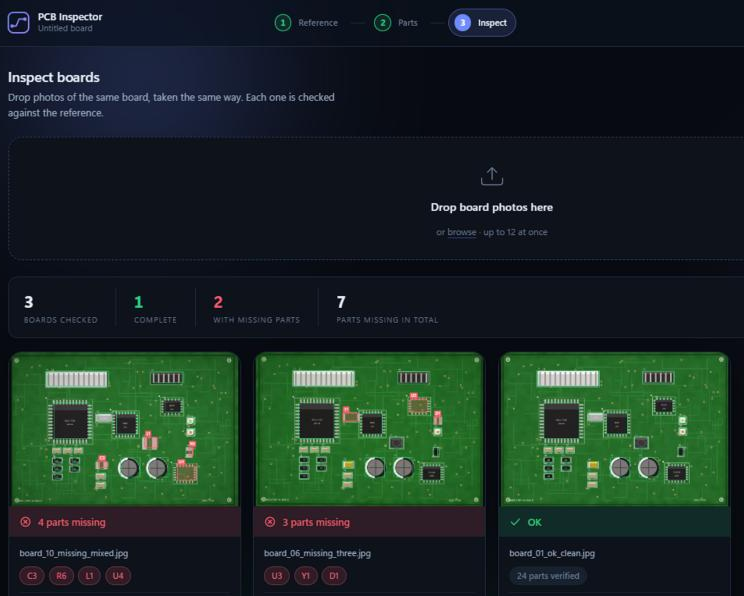

# PCB Missing-Component Inspector

**Take-home Task B: "Which Part Is Missing?"**

Upload a photo of a good board, name the parts on it once, then drop in photos
of boards from the line. For each one the app says which named parts are
missing and shows where, or **OK** in green.

Classical computer vision, no training data, **no network access at runtime**.





---

## Quick start

Requires **Python 3.10+**. Nothing else: no Node, no build step, and nothing
to fetch beyond `pip install`. No model runs unless you ask for one.

```bash
pip install -r requirements.txt
python run.py
```

That starts a local server on `127.0.0.1:8000` and opens your browser. If port
8000 is busy it picks the next free one and prints the address.

```bash
python run.py --port 9000     # choose the port
python run.py --no-browser    # don't open a browser
```

Press `Ctrl+C` to stop.

<details>
<summary>Using a virtual environment (recommended)</summary>

```bash
python -m venv .venv
# Windows:
.venv\Scripts\activate
# macOS / Linux:
source .venv/bin/activate

pip install -r requirements.txt
python run.py
```
</details>

---

## Try it in 60 seconds

Sample boards ship with the repo, so you can see it work before pointing a
camera at anything.

1. Run `python run.py`.
2. **Step 1**: drop in `samples/boards/golden.png`.
3. **Step 2**: click **Auto-detect**. It proposes a box per component; rename
   any you care about, or just continue. (You can also drag boxes by hand,
   that is the normal way.)
4. **Step 3**: drop in several files from `samples/boards/`, for example
   `board_01_ok_clean.jpg`, `board_11_missing_metal.jpg` and
   `board_12_missing_lookalike.jpg`.

The first comes back **OK**; the others name exactly the parts that were
removed. `samples/ground_truth.json` lists the right answer for every file.

Click any board for the detail view: the reference crop next to this board's
crop, the six measurements behind the verdict, and a compare slider.

---

## How it works

For each test photograph:

1. **Register** it onto the reference: SIFT + RANSAC homography, validated
   against a plausibility envelope, with ECC intensity alignment as a fallback.
   A fixed camera still drifts a few pixels, and a few pixels is enough to make
   every comparison fail.
2. **Normalise the nuisances**: robust per-channel exposure matching, then
   sharpness equalisation (blur whichever image is sharper until they match).
   A comparison may only use information that *both* images contain.
3. **Measure each named box** on six independent signals: template correlation,
   SSIM, gradient-outline correlation, CIELAB chroma distance, texture-energy
   ratio and normalised residual.
4. **Fuse** them into one confidence, apply presence vetoes that suppress false
   alarms, and apply a capped correction if the whole photograph is degraded.
5. **Decide**: Present / Needs review / Missing.

Six redundant signals rather than one clever metric, because every single
metric has a failure mode a factory finds within a shift: SSIM is fooled by a
change of focus, colour by a white sticker, edges by exposed pads as busy as
the part that covered them. Agreement across independent measurements is what
survives a board nobody has seen before.

[`ARCHITECTURE.md`](ARCHITECTURE.md) has the diagram and the trade-offs.
[`RESEARCH.md`](RESEARCH.md) has what was compared and rejected.

---

## Measured results

Against the generated benchmark: 80 board photographs spanning the full
nuisance range, **41 named parts** each, **3,280 individual part decisions**:

| Sensitivity | Precision | Recall | False alarms | Missed removals | Boards exactly right |
|---|---|---|---|---|---|
| Conservative | 100% | 100% | 0 | 0 | 80 / 80 |
| **Balanced** (default) | **100%** | **100%** | **0** | **0** | **80 / 80** |
| Sensitive | 100% | 100% | 0 | 0 | 80 / 80 |

The margin matters more than the score: the highest-scoring part that is
actually *present* reaches 0.373, and the weakest genuine removal reaches
0.652. Every threshold in that gap scores perfectly, so the presets sit inside
it rather than balanced on an edge.

About **0.9 s per board** for 41 parts on a laptop CPU.

> **Read this honestly.** The benchmark is rendered, not photographed. Real
> boards glint, sit at slight angles, and collect dust. These numbers are
> evidence that the design is sound and the thresholds are not knife-edge,
> not a prediction of field accuracy. `RESEARCH.md §4` says more.

### Reproduce it

```bash
python tools/generate_samples.py                              # the 12 shipped boards
python tools/evaluate.py --all-presets                        # score them

python tools/generate_samples.py --stress 80 --out samples_stress
python tools/evaluate.py --samples samples_stress --all-presets
python tools/evaluate.py --samples samples_stress --sweep     # operating curve
python tools/evaluate.py --samples samples_stress --worst 10  # worst failures
```

`--sweep` prints precision/recall across thresholds; `--worst` lists the
highest-scoring present parts and the lowest-scoring missing ones, which is the
view that actually drives tuning.

---

## Using it on your own boards

**The reference photo decides everything else.** Fill the frame with the board,
square to the camera, evenly lit, in focus. Then photograph every later board
the same way.

The app corrects for a few pixels of drift, exposure and white-balance changes,
and mild defocus. It cannot correct for a different viewpoint, and it tells
you when alignment was poor rather than guessing.

**Sensitivity** (top right) shifts the operating point:

| Preset | Flags at | Use when |
|---|---|---|
| Conservative | 0.58 | False alarms are expensive; you want certainty |
| Balanced | 0.52 | Default: fixed camera, stable line |
| Sensitive | 0.44 | You would rather check a few extra boards by hand |

Parts between the two thresholds are marked **needs review** in amber rather
than being silently called either way.

### Other things it does

- **Auto-detect** proposes a box per component so you are renaming rather than
  drawing. On the sample board it finds 40 of the 41 parts. It is an
  assistant: edit, delete and add freely.
- **Read labels** (optional, see below) fills in the printed designators.
- **Export / import setup** saves the reference photo and every named part to
  one `.json` file, so a configured board moves between machines.
- **Export report** writes a self-contained HTML file with the images
  embedded, readable on any machine with no server and no application.
- Light and dark themes (light by default), and a **guided tour on first
  run**: reopen it any time from the menu.

### The board canvas

It behaves like a design tool, because that is what everyone's fingers already
know:

| | |
|---|---|
| Scroll, two-finger drag | Pan |
| `Ctrl`/`Cmd` + scroll, pinch | Zoom where the pointer is |
| `Space`-drag, middle-drag, right-drag | Pan |
| Double-click empty board | Fit the whole board back in view |
| Drag on empty board | New part |
| `Shift` + drag on empty | Marquee select |
| `Shift` + click | Add to or remove from the selection |
| `Alt` + drag | Duplicate as you drag |
| Double-click a box, `F2`, `Enter` | Open the part inspector |
| `Enter` while naming | Save and jump to the next part |
| `Ctrl`+`A` / `Ctrl`+`D` | Select all / duplicate |
| Arrows, `Shift`+arrows | Nudge 1 px / 10 px |
| `Ctrl`+`Z` / `Ctrl`+`Shift`+`Z` | Undo / redo |
| `Shift`+`1` / `2` / `0` | Fit, zoom to selection, 100% |

Boxes snap to their neighbours' edges and centres as you drag, with guides, so
a row of passives lines up without fighting the mouse.

### Looking at a part closely

Click any part in the list, or double-click its box on the board, and that
component lifts off the board into the middle of the screen. Drag it to turn
it, scroll to zoom, and type its name on the slab itself. `Enter` saves and
jumps to the next part that still needs a name, so you can work through a
whole board without touching the mouse.

Clicking a row opens the part rather than merely selecting it, because that is
the moment you need it: you are about to type a name for a 20 px component and
you cannot read the designator printed beside it at the zoom the board is at.
Putting that behind a second click on a separate button was making people work
for the thing the feature existed for.

While you work, the Parts header counts what is left (**9 to name**), the
viewer repeats it (**12 of 41 · 9 to name**), and every row still carrying a
generated name is marked, because "Part 31" reads like a real name until you
look twice.

It is worth saying what the tilt is and is not. The top face is the real
photographed pixels. The sides are plain neutral material with no detail,
because a single overhead photo contains no information about what the sides
of a component look like. Drawing something there would be the tool inventing
evidence, which is the one thing an inspection tool must never do.

There is no tool palette on purpose. Figma needs one because it draws a dozen
kinds of object; here there is exactly one, and a mode you can leave in the
wrong state is a trap rather than a feature.

### Checking the names before you inspect

**Review names** shows every part as a photograph with the name you gave it
underneath, in a grid you can scan in one pass. Unnamed parts are flagged,
a filter narrows it to just those, and clicking any picture opens that part
up close to fix it.

This exists because the part list is the right tool for *typing* names and
the wrong one for *checking* them. The mistake this workflow actually
produces is a name that landed on the part next door: you type down a list
while looking at a board, one slip puts every later name a row out, and in a
list of text all forty rows still look correct. In a grid of photographs it is
obvious, because a capacitor labelled `R4` looks wrong. Pressing **Start
inspecting** with placeholders left offers this first; with every part named
it just goes.

### Optional: reading the printed designators

**This is off by default. Out of the box the app runs no model of any kind.**
You switch it on deliberately:

```bash
python run.py --read-labels
```

Then a **Read labels** button appears on the Parts screen. It reads the
designator printed beside each component (R12, C3, U7) and fills it in, so you
correct names instead of typing all of them. On the 41-part sample board it
fills in 32 of them in about 36 seconds and gets none of them wrong.

Nothing is downloaded and no key is needed. The reader is an ONNX text
recogniser that ships inside its wheel, loads from disk and runs on the CPU.

#### How it works, and why it is built that way

Pointing a reader at the whole board, or at a crop around each part, both fail
in the same way: the text is read correctly and then attached to the wrong
component. Nearly every mistake was a neighbour's designator, `R1` read as
`F2`, `C6` as `C4`. On a dense board several labels sit within a few pixels of
several parts, and nearest-neighbour matching cannot tell which belongs to
which. **The hard problem is not reading the text. It is deciding whose text
it is.**

A board does not place its labels at random. A CAD tool prints every
designator at the same offset from its component, so that offset can be
recovered from the board itself:

1. **Survey.** One cheap reading pass over the whole board, which finds about
   half the labels. That is enough.
2. **Learn the convention.** Pair every text found with every part near it.
   Most pairings are wrong, but the wrong ones disagree with each other while
   the right ones all agree, so the offset with the most votes is this board's
   habit. On the sample board, 23 pairs agree on "the centre of the label sits
   6.5 px right of and 13.2 px above the part's top-left corner".
3. **Read the strips.** Each label's position is now known, so the reader is
   handed the narrow strip of board where the text is, instead of a crop
   containing a whole component.

Nothing here is hardcoded to one layout. A board that prints its designators
below and to the right is handled by the same code finding a different offset,
and a board whose labels are too inconsistent to agree on anything is declined
rather than guessed at. Every length is measured in multiples of the board's
own printed text height, which the survey measures, so none of it depends on
image resolution.

#### Measured, on the 41-part sample board

| Approach | Correct | **Wrong** | Time |
|---|---|---|---|
| Vision model (`qwen2.5vl:3b`) | 30 / 41 | **8** | 33 min |
| OCR, one crop per part | 22 / 41 | **14** | 40 s |
| OCR, one pass over the whole board | 15 / 41 | **22** | 4 s |
| **OCR + learned label convention** | **32 / 41** | **0** | **36 s** |
| Typing them by hand | 41 / 41 | **0** | ~2 min |

**The wrong column is the one that matters.** A blank costs you a few seconds
of typing. A confidently wrong designator quietly mislabels the report, looks
entirely plausible, and is caught only by checking against the board, which is
as much work as typing the name was. The vision model got one in five wrong.
This gets none, on either board it was tried on, and when two parts do claim
the same designator every claimant is put back to a placeholder, because one
of them is certainly wrong and nothing says which.

The nine it leaves blank are the chips. Their designators are printed across a
row of bright pins, and at 8 px the glyphs and the pins are one connected
blob.

#### What stops a wrong name

Zero wrong answers is not luck, and it is not one check. A reading has to get
past all of these before it is allowed to become a part's name:

1. **It must look like a designator.** A letter prefix and a number, nothing
   else. This is what rejects a chip's pin row coming back as a Chinese
   character, which is a thing that happens.
2. **It must be where a label belongs.** The reading has to sit within 1.5
   text heights of where this board's learned convention puts the label.
   Measured over 122 correct readings on two boards, the furthest a genuine
   label ever sat was 0.23, so this refuses nothing real while excluding a
   neighbour's label caught at the edge of the crop. Before this limit
   existed, any designator-shaped text anywhere in the strip was accepted.
3. **No two parts may claim the same designator.** When several do, at least
   one is wrong and nothing says which, so every claimant is put back to a
   placeholder rather than guessed between.
4. **The board must have a convention at all.** If too few part/text pairs
   agree on an offset, there is nothing to read against, so the reader
   declines the whole board rather than inventing a placement.
5. **Anything unread stays blank.** It is never filled from the component's
   appearance, from a partial reading, or from the numbering of its
   neighbours, all of which would work on this board and all of which are
   guesses.

Two further guards were measured and deliberately **not** added, because
neither does what it looks like it does:

| Guard | Why it is not here |
|---|---|
| Refuse readings the engine is unsure of | It does not separate them. The one wrong reading available to test against scored 0.83, while correct readings go down to 0.69. Any floor that catches it throws away a great many right answers, which is a cost paid for the appearance of safety. |
| Read each strip at several sizes and keep only readings that agree | The errors are systematic, not random. `R` is read as `F` at every scale, so re-reading the same pixels reproduces the same mistake. Tested against the configuration that does get things wrong: agreement removed none of them and introduced one more. |

The general lesson is in the second one. Re-reading catches noise, and these
mistakes are not noise: an 8 px `R` and an 8 px `F` differ by two pixels, and
the reader is wrong about them the same way every time. A check that cannot
fail differently from the thing it is checking is not a check.

#### Things that were tried and did not work

Recorded because these negative results are the reason the above is shaped the
way it is.

| Idea | Result |
|---|---|
| Isolate the silkscreen by colour before reading | 17 / 41. The glyphs are anti-aliased into the board, so thresholding eats them. |
| Accept a reading only if its letter prefix matches the component's visual type | No new correct answers. Turns wrong answers into blanks, which the convention already does better. |
| Remove long bright structures so pins stop merging with the glyphs | Deletes the text along with the pins. At this scale they are one component. |
| Force a one-to-one assignment of texts to parts | 14 correct became 7. The reader finds only about half the labels, so forcing exclusivity starves the rest. |
| Allow a board two label conventions instead of one | Recovered nothing and introduced 2 wrong answers. |
| Taller strip, pick the text nearest the predicted spot in both axes | 61 of 82, down from 64. The reader wants a tight crop. |
| Tighter strip, to exclude the pins and bodies sharing it | Much worse, 47 of 82, and it starts reading `R7` as `F7`. |
| Erode the bright mask to find solid blocks, then inpaint the pins away | Erosion destroys the strokes too; inpainting changes nothing. |
| Read each strip at three sizes and keep only readings that agree | No gain at all, and three times slower. |

#### Why the last nine cannot be read

Worth stating, because it says where the ceiling actually is. The nine are
not misplaced and they are not buried in clutter: the designator sits within
about a pixel of where the convention predicts, for the parts that fail
exactly as for the parts that work. Asking the reader what it sees there
gives character-level failures, not blanks:

| Printed | Read as |
|---|---|
| `J2` | `2` |
| `R7` | `7` |
| `Q1` | `01` |
| `U5` | `UG` |
| `U2` | a Chinese character |

This is a single-stroke vector font at 8 px, where `R` and `F` differ by two
pixels and `Q` and `0` by three, read by a model trained mainly on Chinese
text, which is why a chip's pin row comes back as a CJK glyph. Nothing about
the crop, the scale or the preprocessing fixes a glyph that does not carry
enough pixels to be distinguished. The remaining routes all amount to
guessing: inferring the letter from what the component looks like, or filling
gaps from the numbering of its neighbours. Boards legitimately have gaps, and
a guessed designator is indistinguishable from a read one by the time it
reaches the report, so the reader leaves them blank and says so.

One caveat in the reader's favour: this board's silkscreen is a single-stroke
vector font at 8 px, which is harder than the solid typeface a real board is
screened with. These numbers probably understate what it would do on real
hardware.

#### Why it is off by default

**Read this part carefully, because it is the one judgement call in the
project.** The brief says: "No online APIs or hosted services ... AI tools
like Gemini may be used only to create practice data, never inside the
solution."

Everything here is local, so the first sentence is satisfied completely. The
second is open to reading, and the strongest argument against a narrow reading
is that a narrow one makes it redundant: if it only meant hosted AI, the
sentence before it already said so. So this project takes the conservative
reading.

A text recogniser is arguably not "an AI tool like Gemini" at all, in the way
a barcode scanner is not. But it is still a convolutional network in a file,
and reading the rule one way for a vision model and another way for this one
would be convenient rather than honest. So both sit behind the same switch:

- **Off unless switched on.** Without `--read-labels` nothing is loaded, no
  button appears, and nothing is slower. Naming by hand is the normal route.
- **It only ever suggests a name.** It has no part whatsoever in deciding
  whether a component is present or missing. That stays entirely in
  `app/vision`: classical, deterministic, explainable.
- **It is not trusted.** Readings are checked against the shape a designator
  really has, and contested ones are refused rather than guessed between.
- **It is removable.** Delete `app/silkscreen.py`, `app/naming.py` and one
  button, and the project is unchanged in every other respect.

If a grader considers any of this out of bounds, the solution stands without
it, and every inspection number in this README was measured with it off.

#### The vision model is still there, as a fallback

`PCB_ENABLE_NAMING=1` with a local Ollama serving `qwen2.5vl:3b` is still
supported, configured with `PCB_OLLAMA_MODEL` and `PCB_OLLAMA_URL`. It is used
only when the text reader is not installed, because it was measured to be
worse on both counts that matter: it reads fewer labels and, unlike the text
reader, it returns wrong ones. A non-local `PCB_OLLAMA_URL` is rejected rather
than dialled, so the offline guarantee cannot be lost by misconfiguration.

Measured, 41 parts, GTX 1650 (4 GB): 48 s per part, about 33 minutes for one
board, 30 correct and 8 wrong. Seven of those eight were the designator of a
different real component. It is kept because a board whose silkscreen the text
reader cannot find may still be legible to a model, and because a machine that
can run a 7B model would do better than these numbers.

### Photos that show only part of the board

A close-up of one corner works. The photo is aligned as usual, and the engine
works out which part of the reference it actually covers:

- parts inside the photo are judged normally;
- parts outside it are marked **Not in view** in grey, excluded from the
  verdict, and counted in the summary (*"OK for 10 of 41 parts"*).

It will not call a part missing because you did not photograph it. On a 50%
crop of a board, 10 of 41 parts were checked, 31 reported as not in view, and
zero false alarms were raised.

---

## Offline guarantee

The brief requires it, so it is worth being precise:

- The server binds to `127.0.0.1` and the application makes **no outbound
  requests**.
- The page loads **no CDN script, no web font, no external stylesheet**. Every
  asset is served from `web/`. Typography uses the platform UI font stack.
- There is **no API key and no hosted service** anywhere in the solution, and
  nothing is ever downloaded at runtime. The inspection engine is OpenCV,
  NumPy, Pillow and FastAPI/uvicorn, and nothing else.
- One optional extra, off unless you pass `--read-labels`, reads the part
  names printed on the board so you do not have to type them. It is an ONNX
  text recogniser that ships inside its own wheel and runs on the CPU, so it
  needs no network and no key either, but it *is* a model and this document
  will not pretend otherwise. It cannot affect any verdict, and with the flag
  off it is never loaded. [Why it is off by default](#why-it-is-off-by-default).
- Your photos stay on your machine, under `data/`, in plain files you can
  delete with a file manager.

Pull your network cable out and everything above still works, including the
exported report.

AI tools were used heavily to *build* this, and to *generate practice data*,
both explicitly allowed. No AI service is called by the solution itself.
See [`AI_COLLAB.md`](AI_COLLAB.md).

---

## Project layout

```
app/
  config.py           every number that affects a verdict, in one file
  main.py             HTTP API (FastAPI)
  imaging.py          decode, EXIF orientation, resizing
  storage.py          projects, parts and runs as plain files on disk
  silkscreen.py       reads the designators printed on the board (optional)
  naming.py           the same job via a local vision model (optional fallback)
  vision/
    registration.py   test frame -> reference frame
    photometric.py    exposure and sharpness equalisation
    metrics.py        the six evidence channels
    inspector.py      fusion, vetoes, thresholds
    suggest.py        candidate component boxes (annotation assist)
web/                  the interface: one HTML file, one stylesheet, ES modules
tools/
  generate_samples.py renders the benchmark boards
  evaluate.py         scores the engine against ground truth
  evaluate_labels.py  scores the label reader against ground truth
samples/              12 boards + ground truth, committed so it runs immediately
data/                 created at runtime; your projects and inspections
```

The vision layer is pure functions over NumPy arrays with no knowledge of HTTP,
storage or the UI, so the whole engine runs head-less from `tools/evaluate.py`.

---

## Troubleshooting

**`ModuleNotFoundError`**: run `pip install -r requirements.txt`. `run.py`
checks dependencies on startup and names anything missing.

**The browser didn't open**: the address is printed in the terminal; open it
manually. Or `python run.py --no-browser`.

**"Could not align this photo to the reference"**: the photo is of a
different board, or from a very different viewpoint. Results are still shown,
flagged as untrustworthy, rather than hidden.

**Lots of parts flagged on a board you believe is fine**: check the
alignment quality in the detail view. If the lighting changed a lot since the
reference was taken, re-shoot the reference under current lighting; that is
more reliable than turning sensitivity down.

**Port already in use**: `run.py` picks the next free port automatically and
prints it.

---

## Task

**Task B: Which Part Is Missing?**
